  

# ⚡ Awesome Reactive Programming

  
  
  
  
  
  

---

## 🎯 Executive Overview & SEO Meta Summary

**Awesome Reactive Programming** is an exhaustively curated index of leading **SaaS developer platforms**, **open-source libraries**, **reactive extensions (ReactiveX)**, **transparent functional reactive programming (FRP) engines**, and **hierarchical state machines (Statecharts)**. 

Modern real-time web applications, high-throughput microservices, and distributed streaming engines rely on reactive paradigms to represent asynchronous data flows, user input events, network responses, and state mutations as declarative, composable streams. By replacing imperatively nested callbacks and mutable global states with **Observables**, **Signals**, **Atom stores**, and **deterministic State Transitions**, development teams achieve predictable concurrency, glitch-free UI updates, and robust error propagation.

---

## 📑 Table of Contents

- [🌐 Sector Overview & Market Dynamics](#-sector-overview--market-dynamics)
- [💼 SaaS & Commercial Reactive Developer Platforms](#-saas--commercial-reactive-developer-platforms)
- [🛠️ Open-Source GitHub Repositories & Libraries](#️-open-source-github-repositories--libraries)
- [🧠 Paradigm Comparison: Observables vs Signals vs Statecharts](#-paradigm-comparison-observables-vs-signals-vs-statecharts)
- [🤝 How to Contribute](#-how-to-contribute)
- [⚖️ Disclaimer & Engineering Tradeoffs](#️-disclaimer--engineering-tradeoffs)
- [📈 Star History](#-star-history)
- [💖 Support & Community](#-support--community)

---

## 🌐 Sector Overview & Market Dynamics

- **Market Size**: The global market for reactive programming architectures, event-driven streaming, and real-time state synchronization is valued at **$15.4 Billion in 2024** and is projected to expand to **$38.2 Billion by 2030**, compounding at a CAGR of **~16.3%**.
- **Market Dynamics & Fragmentation**: The sector exhibits **moderate fragmentation** at the client application and state management layer—where a diverse set of specialized open-source paradigms (e.g., RxJS observable pipes, Zustand stores, Solid signals, and XState statecharts) serve distinct application needs—while transitioning toward **high concentration** at the distributed enterprise event-streaming backbone, where managed Kafka ecosystems (such as Confluent) and hyperscaler cloud message buses dominate mission-critical real-time workloads.

---

## 💼 SaaS & Commercial Reactive Developer Platforms

The following commercial SaaS solutions provide managed backbones, visual state modeling studios, session diagnostics, and event streaming for reactive systems. Repositories and platforms are sorted in descending order by **Company Size (Revenue / Market Valuation)**:

| Platform & Description | Primary Reactive Paradigm | Company Size (Valuation / ARR) | Starting Tier Pricing | Free Tier / Trial Limits |
| :--- | :--- | :--- | :--- | :--- |
| **[Confluent Cloud](https://www.confluent.io/confluent-cloud/)** Enterprise managed event streaming service powered by Apache Kafka and Apache Flink for real-time distributed reactive stream processing. | Distributed Reactive Event Streams & CEP | **$6.5B Market Cap (NASDAQ: CFLT)** / $915M+ ARR | **$0.11 / cluster / hour** (Basic cluster pay-as-you-go, approx $80/month base) | **30-Day Free Trial** with **$400 in platform credits** valid across Kafka clusters, managed connectors, and Stream Governance. |
| **[Sentry](https://sentry.io/)** Developer-first application monitoring and telemetry platform offering deep state capture, Redux/RxJS action tracing, and session replay for reactive frontend apps. | Reactive State Tracing & Error Telemetry | **$3.0B+ Valuation** / $100M+ ARR ($217M raised) | **$26 / month** (Team Plan billed annually, or $29/mo billed monthly) | **Developer Free Plan (Forever)**: 5,000 errors/mo, 10,000 performance units/mo, 50 session replays/mo, 1 user seat, and 30-day data retention. |
| **[Temporal Cloud](https://temporal.io/cloud)** Durable execution platform turning reactive async events, distributed workflows, and state transitions into fault-tolerant persistent code. | Durable Event-Driven Workflows & State Orchestration | **$1.5B+ Valuation** ($120M+ venture funding) | **$25 / month base fee** + $0.0000042 per action executed, storage at $0.042/GB-month | **30-Day Free Trial** with **$200 in usage credits**, unlimited namespaces, and community support access. |
| **[LogRocket](https://logrocket.com/)** Frontend session replay and telemetry platform that records console logs, network requests, Redux/MobX state trees, and DOM mutations for visual time-travel debugging. | Time-Travel State Replay & Reactive UI Inspection | **$300M+ Valuation** / $35M+ ARR ($42M raised) | **$99 / month** (Team Tier billed annually for 10,000 sessions/month) | **Free Forever Tier**: 1,000 recorded sessions/month, 1-month data retention, full Redux state tree inspection, and user session replay. |
| **[Ably Realtime](https://ably.com/)** Serverless real-time messaging and state sync platform offering pub/sub channels, presence detection, and reactive event streaming with guaranteed order delivery. | Pub/Sub Reactive Message Streams & Presence Sync | **$250M+ Valuation** ($70M+ venture funding) | **$29 / month** (Standard plan with bursting at $2.50 per 1M messages) | **Free Forever Tier**: 6,000,000 messages/month, 200 peak concurrent connections, and 200 peak concurrent channels. |
| **[Inngest](https://www.inngest.com/)** Event-driven background orchestration platform providing reactive step functions, durable queues, and state recovery without manual worker infrastructure. | Serverless Event-Driven Reactive Functions | **$35M+ Valuation** ($9.1M venture funding) | **$75 / month** (Team Plan for 100,000 step runs/month and 5 user seats) | **Free Forever Tier**: 25,000 step runs/month, 3 team member seats, and 7-day execution log retention. |
| **[Stately (Stately.ai)](https://stately.ai/)** Collaborative visual state machine studio and simulation platform built by the creators of XState, enabling teams to visually design, test, and export reactive statecharts. | Visual Statechart Studio & AI Agent Workflows | **$30M+ Valuation** ($12M venture funding) | **$20 / month / user** (Pro Plan billed annually, or $24/mo billed monthly) | **Free Forever (Community)**: Unlimited public projects, up to 3 private projects, visual state machine simulator, and direct XState code export. |

---

## 🛠️ Open-Source GitHub Repositories & Libraries

Every featured open-source repository below is actively maintained, battle-tested in enterprise production, and accompanied by a live star count badge linking directly to its GitHub stargazers page. Repositories are sorted in **descending order by GitHub star count**:

1. **[Redux](https://github.com/reduxjs/redux)**   
   **Predictable state container for JavaScript apps** — MIT licensed. Redux pioneered unidirectional data flow in the modern web with pure reducers, immutable actions, and a single centralized store. Enables full time-travel debugging via Redux DevTools and predictable state replay across complex applications.

2. **[Zustand](https://github.com/pmndrs/zustand)**   
   **Bear necessities for state management in React** — MIT licensed. A small, fast, and scalable bearbones state-management solution using simplified flux principles. Based on reactive subscriptions without Context API overhead, preventing unnecessary re-renders with fine-grained selectors.

3. **[RxJava](https://github.com/ReactiveX/RxJava)**   
   **Reactive Extensions for the JVM** — Apache 2.0 licensed. A library for composing asynchronous and event-based programs by using observable sequences on the JVM. Provides backpressure handling via Flowable, non-blocking schedulers, and rich functional operators.

4. **[SolidJS](https://github.com/solidjs/solid)**   
   **Fine-grained reactive declarative JavaScript library for building user interfaces** — MIT licensed. Solid uses fine-grained reactive primitives (Signals, Memos, Effects) that compile directly to raw DOM updates without a Virtual DOM, yielding near-metal runtime performance.

5. **[RxJS](https://github.com/ReactiveX/rxjs)**   
   **The Reactive Extensions for JavaScript** — Apache 2.0 licensed. The gold standard for functional reactive stream programming in TypeScript/JavaScript. Features composable pipeable operators (`map`, `filter`, `switchMap`, `debounceTime`), schedulers, and distinction between cold unicast and hot multicast observables. Standard in Angular.

6. **[XState](https://github.com/statelyai/xstate)**   
   **Actor-model state machines and statecharts for the modern web** — MIT licensed. Formally eliminates invalid application states by modeling workflows as explicit finite state machines and statecharts. Features visual simulation, nested/parallel states, event-driven transitions, and actor communication.

7. **[MobX](https://github.com/mobxjs/mobx)**   
   **Simple, scalable state management through transparent functional reactive programming (TFRP)** — MIT licensed. Automatically tracks observable properties at runtime through ES6 proxies. Eliminates manual selectors, subscriber tracking, and normalization: anything that can be derived from the application state is derived automatically.

8. **[RxSwift](https://github.com/ReactiveX/RxSwift)**   
   **Reactive Programming in Swift** — MIT licensed. Port of ReactiveX to the Swift ecosystem, enabling native iOS, macOS, and server-side Swift developers to construct declarative async pipelines, data-bound UI controls, and reactive network abstractions.

9. **[Redux-Saga](https://github.com/redux-saga/redux-saga)**   
   **An alternative side effect model for Redux apps** — MIT licensed. Uses ES6 Generators to make asynchronous side effects (data fetching, concurrent tasks, browser caches) feel synchronous, easily testable, and reactive to incoming Redux action streams.

10. **[Jotai](https://github.com/pmndrs/jotai)**   
    **Primitive and flexible state management for React** — MIT licensed. Implements an atomic reactivity model inspired by Recoil. Bottom-up approach where state is divided into composable atoms, minimizing re-renders with automatic garbage collection and Suspense support.

11. **[Recoil](https://github.com/facebookexperimental/Recoil)**   
    **Experimental state management library for React** — MIT licensed. Created by Meta to manage synchronized reactive state in React trees using atoms (units of state) and selectors (pure derived functions), supporting React Concurrent Mode.

12. **[Eclipse Vert.x](https://github.com/eclipse-vertx/vert.x)**   
    **A tool-kit for building reactive applications on the JVM** — Eclipse Public License 2.0 / Apache 2.0. Vert.x is event-driven and non-blocking, allowing applications to handle substantial concurrency with minimal kernel threads using an event-loop actor pattern.

13. **[Redux Toolkit](https://github.com/reduxjs/redux-toolkit)**   
    **The official, opinionated, batteries-included toolset for efficient Redux development** — MIT licensed. Simplifies Redux store configuration, includes RTK Query for data fetching, and integrates Immer to allow immutable updates with mutable syntax.

14. **[React Native Reanimated](https://github.com/software-mansion/react-native-reanimated)**   
    **React Native's Animated library reimplemented** — MIT licensed. Pure reactive UI animation engine that evaluates gesture events and interpolations on the native UI thread, bypassing the JavaScript bridge for 60/120 FPS performance.

15. **[Cycle.js](https://github.com/cyclejs/cyclejs)**   
    **A functional and reactive JavaScript framework for predictable code** — MIT licensed. Models applications as a pure cycle of observables: `Computer(Human(Computer...))`. User interactions are input streams (sources), and DOM/network effects are output streams (sinks).

16. **[ReactiveUI](https://github.com/reactiveui/ReactiveUI)**   
    **An advanced, composable, functional reactive Model-View-ViewModel framework for all .NET platforms** — MIT licensed. Combines Rx.NET observables with MVVM data-binding for cross-platform .NET (MAUI, WPF, Avalonia, Uno, Xamarin).

17. **[Nano Stores](https://github.com/nanostores/nanostores)**   
    **Tiny state manager for React, React Native, Preact, Vue, Svelte, and vanilla JS** — MIT licensed. Framework-agnostic atomic reactive stores with an ultra-lightweight footprint (<1 KB), tree-shaking, and lazy tree subscriptions.

18. **[RxKotlin](https://github.com/ReactiveX/RxKotlin)**   
    **RxJava bindings for Kotlin** — Apache 2.0 licensed. Adds idiomatic Kotlin extension functions (`subscribeBy`, `toObservable`, `zipWith`) to RxJava, streamlining functional reactive programming on Android and server-side Kotlin.

19. **[Bacon.js](https://github.com/baconjs/bacon.js)**   
    **A small functional reactive programming library for TypeScript and JavaScript** — MIT licensed. Focuses strictly on hot streams (EventStreams) and current state values (Properties). Deliberately prevents cold-stream re-execution and provides built-in glitch avoidance.

20. **[Project Reactor](https://github.com/reactor/reactor-core)**   
    **Non-blocking reactive foundation for the JVM** — Apache 2.0 licensed. The core engine underpinning Spring Framework 5/6 and Spring WebFlux. Implements the Reactive Streams specification with `Flux` [0..N] and `Mono` [0..1] pipeline primitives.

21. **[RxGo](https://github.com/ReactiveX/RxGo)**   
    **Reactive Extensions for the Go language** — Apache 2.0 licensed. Idiomatic Go implementation of ReactiveX utilizing Go channels, goroutines, and non-blocking pipelines with concurrency operators and backpressure handling.

22. **[RxPY](https://github.com/ReactiveX/RxPY)**   
    **The Reactive Extensions for Python** — Apache 2.0 licensed. Brings observable streams, composition operators, and concurrency schedulers to Python 3, enabling declarative asynchronous event-driven pipelines.

23. **[Reactive Streams JVM](https://github.com/reactive-streams/reactive-streams-jvm)**   
    **Reactive Streams standard specification for the JVM** — CC0 1.0 Universal. The standardized SPI specifying non-blocking backpressure across asynchronous stream boundaries; foundation for Java 9 `java.util.concurrent.Flow`, Akka, Vert.x, and Project Reactor.

24. **[Effector](https://github.com/effector/effector)**   
    **Business logic manager for modern applications** — MIT licensed. Framework-agnostic reactive architecture composed of Stores (state containers), Events (triggers), and Effects (isolated async side effects) with explicit static dependency flow.

25. **[Preact Signals](https://github.com/preactjs/signals)**   
    **Extremely fast state management with reactive signals** — MIT licensed. Standalone fine-grained reactive primitives that automatically update the DOM directly without diffing the Virtual DOM tree, usable across Preact, React, and vanilla JavaScript.

26. **[RxDart](https://github.com/ReactiveX/rxdart)**   
    **Reactive Extensions for Dart and Flutter** — Apache 2.0 licensed. Extends Dart's native `Stream` and `StreamController` with ReactiveX operators (`debounce`, `switchMap`, `combineLatest`), serving as the foundation for the Flutter BLoC pattern.

27. **[Monix](https://github.com/monix/monix)**   
    **Asynchronous, reactive programming for Scala and Scala.js** — Apache 2.0 licensed. High-performance, functional library for composing reactive systems with strong backpressure semantics, cancellable tasks, and type-safe observable streams.

28. **[DynamicData](https://github.com/reactivemarbles/DynamicData)**   
    **Reactive collections based on Rx.NET** — MIT licensed. Brings observable change sets to collections in .NET, enabling developers to filter, sort, transform, and aggregate complex in-memory datasets reactively with automatic UI synchronization.

29. **[Kefir.js](https://github.com/kefirjs/kefir)**   
    **Reactive programming library inspired by Bacon.js and RxJS** — MIT licensed. Engineered with an explicit emphasis on low memory allocation, high raw event throughput, and first-class Flow typing for frontend stream composition.

30. **[SmallRye Mutiny](https://github.com/smallrye/smallrye-mutiny)**   
    **An intuitive event-driven reactive programming library** — Apache 2.0 licensed. Primary reactive programming model powering Quarkus. Provides guided fluent APIs with `Uni` (single value or failure) and `Multi` (stream of items with backpressure).

31. **[samber/ro](https://github.com/samber/ro)**   
    **A functional reactive programming library for Go** — MIT licensed. Provides declarative, composable stream pipelines on top of Go generics, including channel transformation, filtering, debouncing, and batching.

32. **[Most.js (@most/core)](https://github.com/mostjs/core)**   
    **High-performance functional event stream architecture** — MIT licensed. Features a modular, curried, tree-shakeable API designed to achieve near-native JavaScript array iteration speeds across reactive streams.

---

## 🧠 Paradigm Comparison: Observables vs Signals vs Statecharts

| Metric / Feature | 🌊 Observables (RxJS / RxJava) | 📡 Fine-Grained Signals (Solid / Preact) | 🔄 Statecharts (XState) | 🏪 Immutable Stores (Redux / Zustand) |
| :--- | :--- | :--- | :--- | :--- |
| **Primary Abstraction** | Stream of events over time (`pipe(operators)`) | Reactive value container (`getter / setter`) | States, Transitions, Events, Guards | Global state tree + dispatched actions |
| **Evaluation Model** | Push-based event pipeline | Hybrid push-pull dependency graph | Event-driven deterministic state machine | Unidirectional dispatched reducer |
| **Glitch Prevention** | Handled via specific schedulers / operators | Built-in topological dependency sorting | Guaranteed by single active state rules | Single store updates synchronously |
| **Temporal Operators** | Rich native support (`debounce`, `throttle`, `window`) | Requires external timer effects | Modelable via delayed events (`after: 500`) | Delegated to middleware (Sagas / Thunks) |
| **Ideal Use Case** | Async coordination, WebSocket streams, UI events | High-frequency granular UI updates | Multi-step wizards, authentication flows, agents | Predictable global audit logs and shared caching |

---

## 🤝 How to Contribute

Contributions from the developer community are warmly welcomed! To suggest a new open-source library or SaaS platform:

1. **Fork the Repository**: Create your personal fork on GitHub.
2. **Add Entry**: Open [`README.md`](file:///C:/Users/hp/Documents/Projects/Awesome-Reactive-Programming/README.md) and insert your tool following the established format:
   - For **Open-Source**: Include the repository name, live stargazers social badge (`style=social&color=white`), license, and a concise technical description. Ensure the list remains sorted descending by star count.
   - For **SaaS**: Include the platform name, specific starting tier price, and specific free tier / trial limits.
3. **Submit a Pull Request**: Provide a clear explanation of why the tool fits the reactive programming ecosystem.

---

## ⚖️ Disclaimer & Engineering Tradeoffs

- **Community-Curated**: This list is independently maintained as a community resource and does not constitute a formal commercial endorsement.
- **Architectural Differences**:
  - **Cold vs Hot Streams**: RxJS creates cold unicast observables by default (re-executes source per subscription), whereas Bacon.js and Most.js operate exclusively on hot multicast streams.
  - **Error Propagation**: RxJS automatically catches exceptions in operators and terminates the pipeline with an error notification; Bacon.js requires explicit `Bacon.try()` and does not end streams upon error unless explicitly instructed.
  - **Reactivity Compilers**: Proxy-based transparent reactivity (e.g., MobX) may conflict with automated memoizing compilers (such as the React Compiler) if dependencies are read outside tracked component render scopes.
  - **Memory Lifecycle**: Open-source observable pipelines require explicit subscription disposal (`takeUntilDestroyed`, `unsubscribe`) to prevent memory leaks in single-page applications.

---

## 📈 Star History

---

## 💖 Support & Community

Thank you for exploring and building with **Awesome Reactive Programming**! If you find this curated directory valuable for your architectural decisions, production applications, or learning journey, please consider supporting the project:

- ⭐ **Star this repository** on GitHub to help engineers and teams discover reactive programming tools.
- 🍴 **Fork and contribute** your favorite reactive tools, tutorials, or architecture guides.
- 📢 **Share with peers** on X (Twitter), LinkedIn, Reddit, and Discord developer communities.
- ☕ **Sponsor & Buy a Coffee**: Support continuous open-source curation and ecosystem maintenance via the [GitHub Sponsors Dashboard](https://github.com/sponsors/ishandutta2007).

Made with ❤️ for frontend architects, distributed systems engineers, and the global reactive development community.
